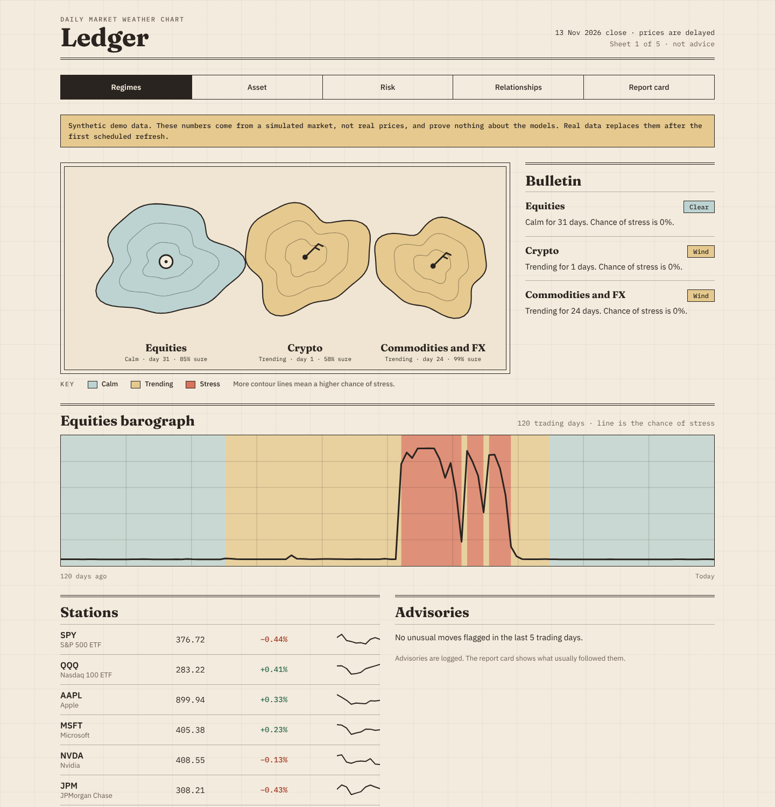
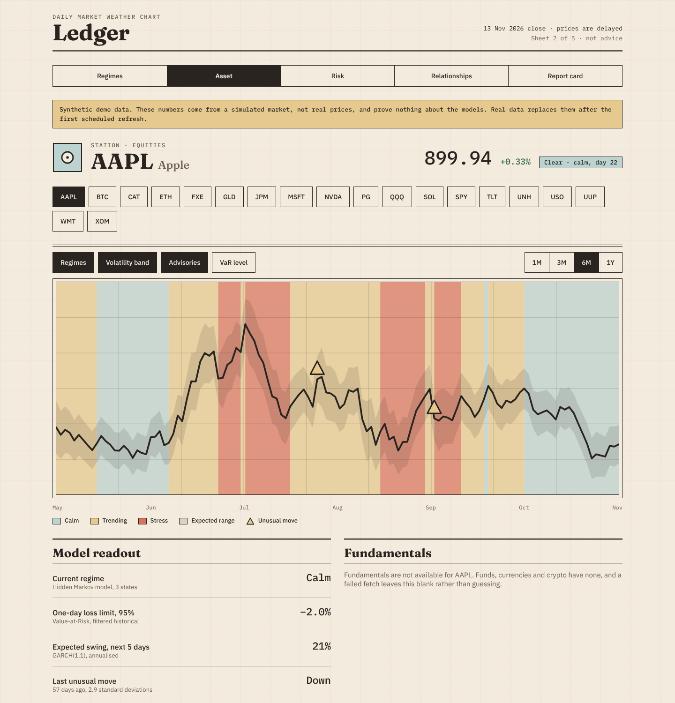
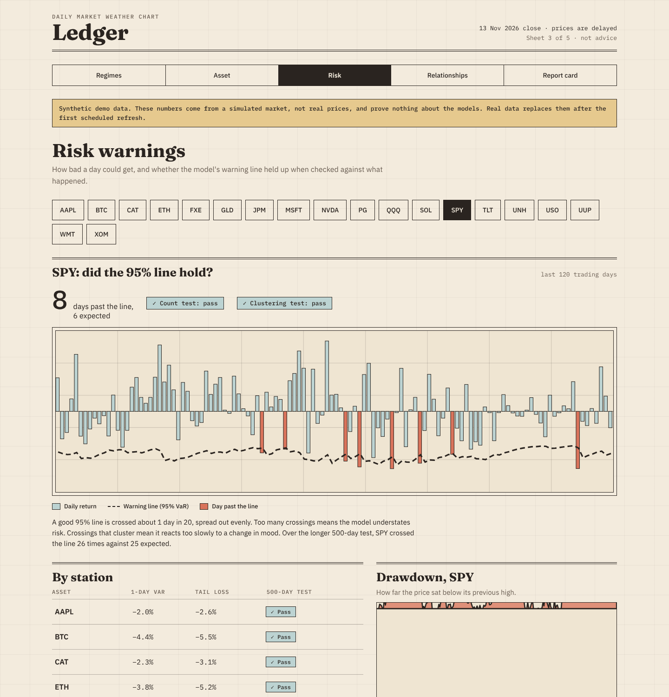
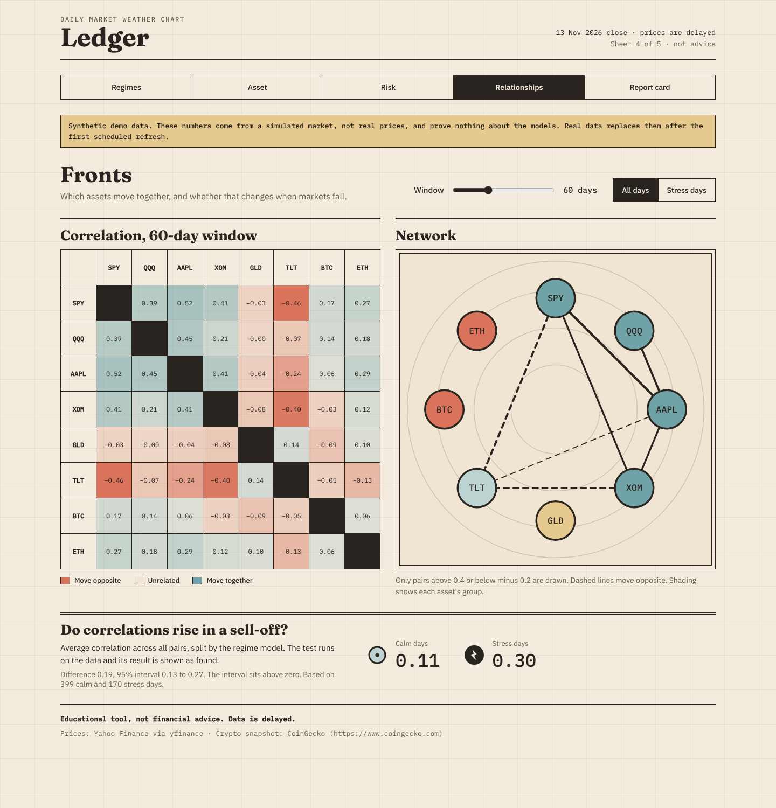
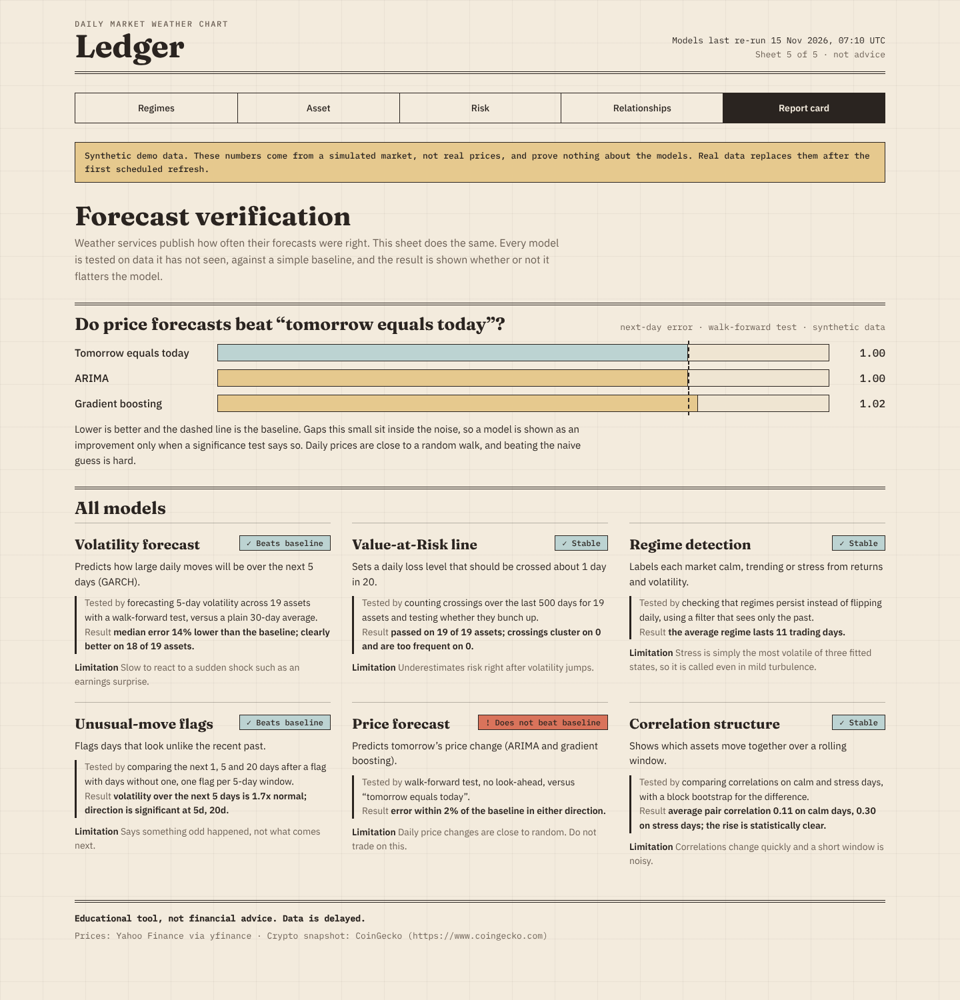

# Ledger

A daily market weather chart for stocks, crypto and commodities. Each asset class is a region on a map, coloured by its current regime (calm, trending, stress). Behind the map are models that are tested on data they have not seen, against simple baselines, and the results are shown as found, including the ones that do not flatter the models.

Live site: _add the Netlify URL here after the first deploy._



| | |
|---|---|
|  |  |
|  |  |

> **The screenshots and the data committed in `web/public/data` are synthetic.** They come from a simulated market with built-in volatility clustering and regimes, so the models naturally look good on it. That proves the code runs and the checks work. It says nothing about real markets. Real numbers appear after the first run of the refresh workflow, and the site shows a banner while the data is synthetic.

## What is in it

- **Regimes**: a 3-state Gaussian hidden Markov model on returns and volatility, filtered forward only (no smoothing, so no look-ahead). States are named calm, trending and stress by their volatility rank.
- **Asset**: price with regime shading, a volatility band, unusual-move marks and an optional VaR line, plus a model readout and fundamentals when available.
- **Risk**: 1-day 95% Value-at-Risk by filtered historical simulation on a GARCH(1,1) volatility, backtested over 500 days with the Kupiec count test and the Christoffersen independence test, compared against plain historical and normal VaR.
- **Relationships**: rolling correlations in several windows, and a block-bootstrap test of whether average correlation is higher on stress days.
- **Report card**: every model, how it was tested, what came out, and its limitation. Price forecasts (ARIMA, gradient boosting) are compared with "tomorrow equals today" using a Diebold-Mariano test.

## How it is checked

- Walk-forward evaluation everywhere: models are fit on the past and scored on the next block.
- `tests/leakage.py` has a causality check: changing future data must not change any past output. A mutation test (swapping the filter for a smoother) confirms it fails when look-ahead is introduced.
- Python: 33 fast tests plus one end-to-end test. Web: type check, 5 unit tests, static build. CI runs all of them.
- The JSON written by the models is validated against a schema before the site reads it.

## What did not work, and limits

- On synthetic data the regime model calls stress about three times as often as the simulator produces it. Stress is simply the most volatile of three fitted states, so it fires whenever volatility is high relative to the fit. Expect the same tendency on real data.
- Price forecasts are not expected to beat "tomorrow equals today". The report card shows the gap and whether it is significant, and claims an improvement only when it is.
- Nothing here is a trading signal. No profit claim is made, and none is supported by the tests.
- Fundamentals come from Yahoo through `yfinance`. That code has not been run against live Yahoo from the build environment. If it fails, the page says "not available" instead of guessing.
- Data is daily and delayed. Crypto history comes from Yahoo (BTC-USD and similar); CoinGecko is used only for a current snapshot.
- Yahoo data through `yfinance` is unofficial and can change or break without notice.

## How it runs

- `refresh.yml` runs every day at 22:30 UTC (and on demand). It fetches prices into a DuckDB cache, runs all models, and commits changed JSON to `main` as `data: refresh <date>`.
- Netlify builds on each push to `main` (`netlify.toml`: base `web`, command `npm run build`, publish `out`). The site is a static export that reads the JSON at build time.
- If a ticker cannot be fetched, its old data is kept and marked stale on the page.

## Run it locally

```bash
python -m venv .venv && . .venv/bin/activate
pip install -r requirements.txt
python scripts/fetch.py            # real data; add --synthetic for the simulator
python scripts/run_all.py --fundamentals
cd web && npm install && npm run dev
```

Tests: `python -m pytest -q -m "not slow"` and `cd web && npm test`.

## Backtest results

Real results are not in yet. The table below is filled from the first real refresh (see the Report card sheet, which is always current).

| Model | Verdict on real data |
|---|---|
| Volatility forecast | pending first refresh |
| Value-at-Risk line | pending first refresh |
| Regime detection | pending first refresh |
| Unusual-move flags | pending first refresh |
| Price forecast | pending first refresh |
| Correlation structure | pending first refresh |

## Data credits

Prices: Yahoo Finance via `yfinance`. Crypto snapshot: [CoinGecko](https://www.coingecko.com). Fonts: Fraunces, IBM Plex Sans and IBM Plex Mono (SIL Open Font License).

Educational tool, not financial advice. Data is delayed.

`design/` holds the design canvas files the web app was built from.
